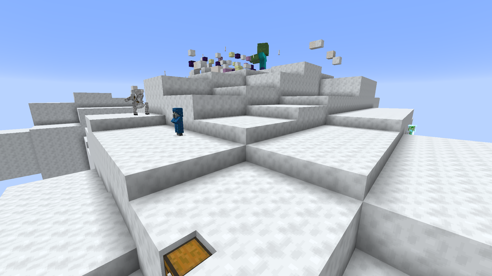

# Cloud Kingdoms

Clouds you can land on: seven kinds of floating island in the overworld cloud layer, each with its own ruins, garrison and loot, plus a magic bean that grows a beanstalk up to them.

From the ground a kingdom looks like the rest of the cloud layer. Its underside is flat at y=192, where the client draws clouds, and its outline is squared off to a 6-block grid, so from below it reads as weather.

## Screenshots



## Finding one

```
/locate structure cloud-kingdoms-justfatlard:cloud_spire
```

The structures are `cloud_bank`, `cloud_tarn`, `cloud_spire`, `cloud_forge`, `cloud_homestead`, `cloud_citadel` and `cloud_wreck`. They generate over any overworld biome.

Two tiers can be spotted from the ground: a **tarn rains** out of its underside and a **forge smokes** out of its own.

An operator can build one in the sky over where they are standing:

```
/cloudkingdom citadel          # random seed
/cloudkingdom citadel 12345    # reproducible
```

The tier is one of `bank`, `tarn`, `spire`, `forge`, `homestead`, `citadel` or `wreck`.

## Magic beans

The way up for anyone without an elytra.

A **magic bean** turns up in about one in nineteen chests in village houses (plains, savanna, snowy, taiga, desert), shipwreck supply chests, pillager outposts, jungle temples and desert pyramids. A wandering trader sometimes sells one for 24 emeralds. Beans are not in the cloud chests.

Plant one on top of a solid block. It needs **water within four blocks of the roots, or open sky** above them; if it has neither, it says so and is not used up. It waits for nightfall, then grows a **beanstalk** straight up to y=202, ten blocks above the cloud layer, through anything in the way except unbreakable blocks like bedrock. What it breaks drops as items at the bottom. Once started it keeps growing through dawn, and a stalk that stops for lack of water starts again when water is placed beside it.

The stalk is climbable. Cut any block of it and everything above comes down, dropping nothing.

## The seven tiers

| | Cloud | What is on it | Who is there |
|---|---|---|---|
| **Bank** | ~70 blocks across | Cairns marking buried caches, 2-5 chests, a buried breeze spawner, sometimes a caged allay | 5-10: breezes, sometimes an illusioner |
| **Tarn** | ~90 blocks | Ponds cut into the deck, lily pads, 2-3 chests | 5-15: axolotls, frogs, sometimes an allay or two, nothing hostile |
| **Spire** | ~95 blocks | A ruined watchtower, arches, 2-4 chests, usually a vex spawner | 5-14: vexes, breezes, sometimes skeleton horsemen or illusioners |
| **Forge** | ~115 blocks | A blackstone smithy, lava basins cut into the deck, 3-4 chests, a blaze spawner, sometimes a ruined portal | 6-13: blazes, magma cubes, striders in the lava |
| **Homestead** | ~100 blocks | A piglin family's hut, a nether wart farm, a ruined portal, 2-3 chests | 4-8 piglins, children among them, sometimes a brute |
| **Citadel** | ~140 blocks | A pillar ring, a sealed vault, 4-6 chests, a breeze spawner, sometimes a vex spawner | 11-25: a giant, charged creepers, shulkers, horsemen, vexes, breezes, illusioners |
| **Wreck** | ~105 blocks | An End ship crashed into the deck, 3-4 deck chests | 2-5: breezes, sometimes an illusioner, plus the ship's own shulkers |

Counts roll per kingdom. Everything placed with the kingdom is persistent and does not despawn.

Rarity, as structure-set spacing in chunks (a data pack can change any of them):

| Bank | Tarn | Spire | Forge | Homestead | Citadel | Wreck |
|---|---|---|---|---|---|---|
| 64 | 112 | 144 | 208 | 288 | 320 | 384 |

### Bank

Nothing is built on a bank; the loot is under the deck. Each **cairn** (a small stack of stones) has a 55% chance of a chest under it, buried beneath a single block of cloud. One taller cairn near the middle marks a **sealed cell with a breeze spawner** instead. One bank in four has a **hutch**, a small iron-bar cage on a stone plinth with an allay in it; break the bars to free it. There is no cover from the breezes.

Chests: breeze rods, wind charges, phantom membrane, iron, gold, emeralds, ender pearls, the odd diamond or name tag, rarely an enchanted golden apple.

### Tarn

The only tier with nothing hostile. Its ponds sit in bowls cut into the cloud, so it rains underneath.

Chests: fish, clay, lily pads, prismarine shards, water buckets, rarely a heart of the sea, an axolotl in a bucket or a trident.

### Spire

A ruined watchtower with a chest inside, and three times in five a vex spawner.

Chests: wind charges, arrows, iron, gold, emeralds, ender pearls, saddles, iron or diamond horse armor, the odd diamond.

### Forge

A blackstone smithy with a lava pan in its floor, ringed in magma blocks, and a damaged anvil. The back of the hall is a sealed room with a **blaze spawner**. Lava basins out on the deck have striders in them. One wall block in ten is gilded blackstone. Two forges in five have one of vanilla's ruined portals on the deck, with its own chest; a portal that comes out with a complete frame can be lit.

Chests: blaze rods, magma cream, fire charges, gold, obsidian, quartz, saddles, warped fungus on a stick, and rarely ancient debris or netherite scrap.

### Homestead

A crimson-plank hut on blackstone footings, a nether wart and fungus farm, and a ruined portal off to one side. The piglins behave as piglins do: **wear gold** and they leave you alone; come without it, open their chests, or break the gold block in the hut and they attack. They do not zombify in the overworld.

Chests: nether wart, fungi, soul sand, gold nuggets and ingots, cooked porkchop, golden carrots, rarely a golden apple or a gold block.

### Citadel

A ring of broken pillars around a sealed vault with a breeze spawner inside, and half the time a vex spawner in the hall. Every citadel has a **giant**: a hundred hearts, fifty attack damage, walking at a zombie's pace. This mod gives giants AI, so a summoned one fights too. One citadel in five has a **Golden Goose** beside the giant: a white chicken that lays 1-3 gold nuggets instead of an egg every 5-10 minutes.

Chests: ender pearls, chorus fruit, shulker shells, end rods, End stone and purpur, obsidian, diamonds, diamond sword, chestplate or boots, rarely an elytra.

### Wreck

Vanilla's End city ship, sunk into the deck at the end of the furrow it ploughed, with part of the hull broken off. Everything vanilla puts on the ship is there: the elytra in its frame, the dragon head, the brewing stands, the two End city treasure chests and the shulkers. The extra chests on the deck hold purpur, End stone, chorus fruit, ender pearls, shulker shells, end rods, diamonds, and rarely dragon's breath.

## Cloud blocks

The mod adds one block, **cloud**. It mines with a shovel and drops **only with Silk Touch**. Landing on it does **no fall damage** from any height.

**Below y=192 it floats up**, four blocks a second, until something stops it. Cloud joined face to face rises **as one mass**, so a raft built under the line lifts together and arrives together. A mass over 2,048 blocks rises block by block instead.

Three things stop it:

- **The layer.** At or above y=192 cloud never moves; up there it is an ordinary building block.
- **Something solid overhead**, until that is removed.
- **Slime or honey touching any block of the mass.** One sticky block moors the whole raft. The list is the block tag `cloud-kingdoms-justfatlard:anchors_cloud`, which a data pack can extend.

A rising cloud carries whatever is standing on it, and a water or lava source sitting on it rides up with it.

**Cloud leaks.** A cloud block with air below it and water or lava above it, through unbroken cloud, drips water or lava particles from its underside. Nothing actually falls. A pond sunk into a deck you build rains under it too.

## Advancements

| | |
|---|---|
| **Worth More Than a Cow** | Come by a magic bean |
| **Head in the Clouds** | Stand on a cloud |
| **Fee-Fi-Fo-Fum** | Take a piece of cloud for yourself |

## With other mods

- **[Village Quests](https://github.com/fatlard1993/village-quests)**: villagers under a cloud kingdom remark on it (rain from a tarn, smoke from a forge, a cloud that never drifts). A beanstalk in a village can get you an errand to bring roofing to patch the hole it made, a player carrying a magic bean gets told where not to plant it, and a Golden Goose that wanders into town gets noticed.
- **[Block Tip](https://github.com/fatlard1993/block-tip)**: the beanstalk's card shows a bamboo icon.

## Pandorical

Cloud Kingdoms goes on the server only, and **Pandorical is required there and on every player's client**: the cloud and the beanstalk are new blocks and the magic bean is a new item, and a client without Pandorical has no entry for them.

## Development

Installing is in [DEVELOPMENT.md](DEVELOPMENT.md).

## License

MIT, see [LICENSE](LICENSE).
